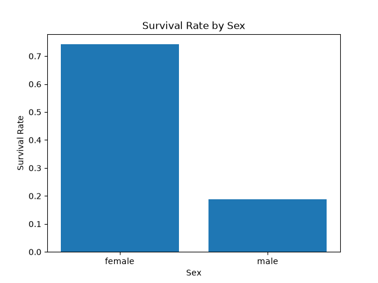
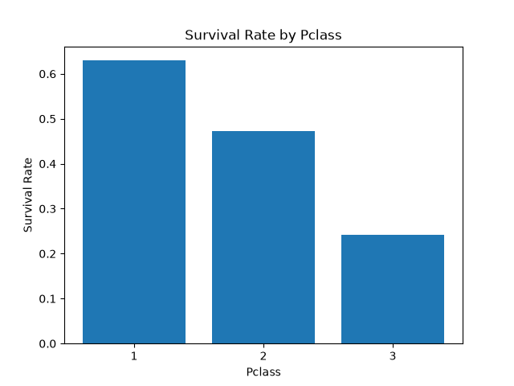
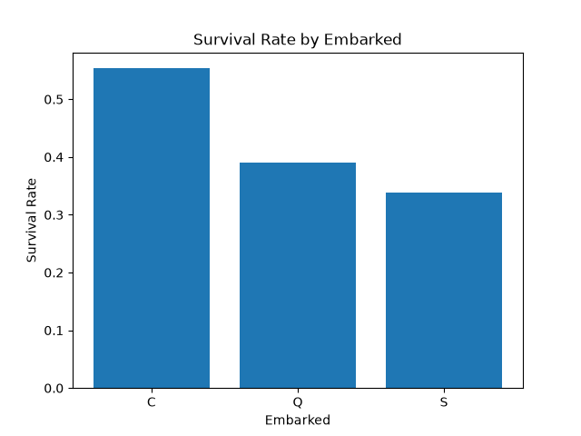

# Titanic Survival Analysis

Exploratory data analysis of the Titanic dataset using Python (Pandas, Matplotlib).

## Question
Which passengers were more likely to survive?

## Data
891 passengers, 12 columns (public Titanic dataset).

## Data Cleaning
- Age: 177 missing values were filled with the median age
- Embarked: 2 missing values were filled with the most common port (S)
- Cabin: dropped (687 of 891 values missing)

## Findings
- Overall survival rate: 38.4%
- Women: 74.2% survived, men: 18.9%
- First class: 63.0%, second class: 47.3%, third class: 24.2%
- By port: Cherbourg 55.4%, Queenstown 39.0%, Southampton 33.9%

## Charts




## How to run
```
pip install pandas matplotlib
python analysis.py
```

## What I learned
I learned how to turn data into charts for easier understanding, how data is organized in rows and columns, how to clean missing values, and how to find answers to different questions from data.